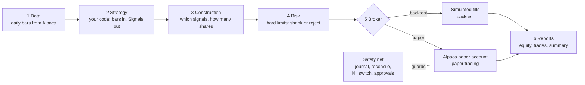
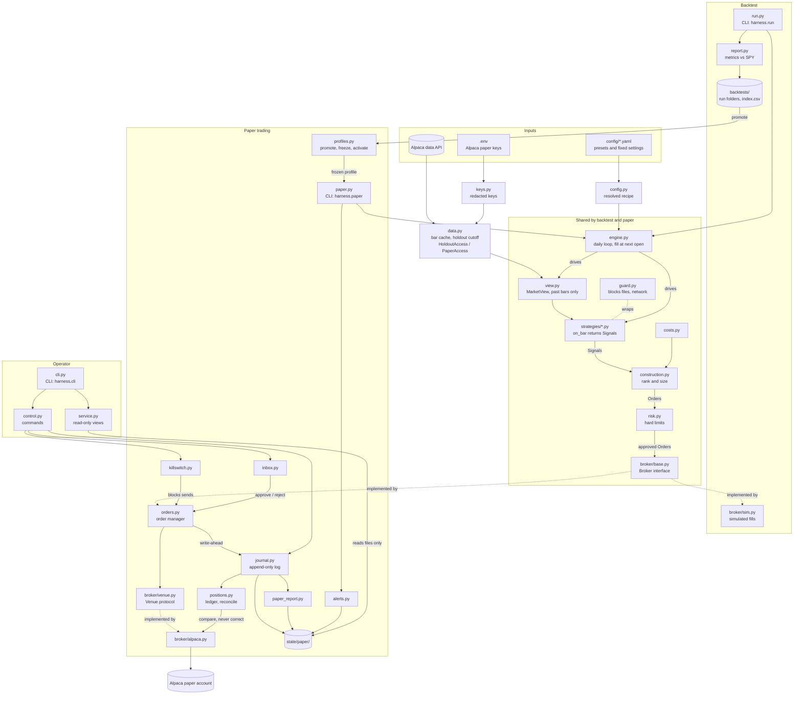
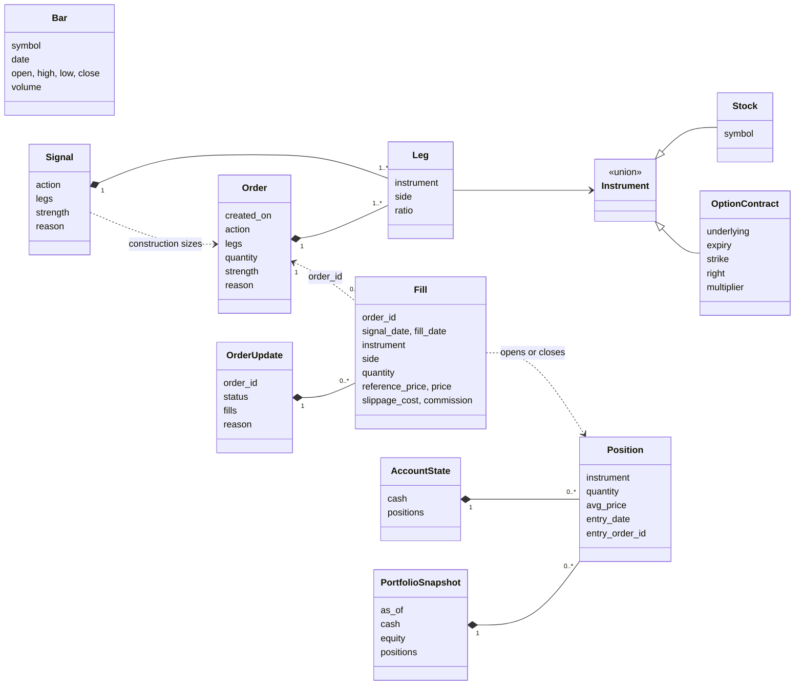
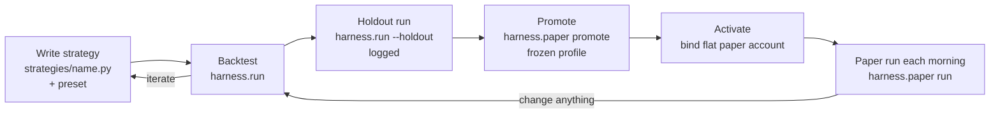

# Diagrams

How the harness fits together, drawn from the code (module imports and `harness/models.py`).
File-level detail is in the Components table in [ARCHITECTURE.md](../ARCHITECTURE.md).
GitHub renders these Mermaid diagrams; in VS Code, a Mermaid preview extension does.

## 1. Overview: the big picture

Start here. Each day, bars go in and trades come out. The only thing that differs
between a backtest and paper trading is the broker at the end.

How the overview boxes map to the files in the detailed diagram below:

| Overview box | Files (section 2) |
|---|---|
| 1 Data | `config.py`, `keys.py`, `data.py`, `view.py` |
| 2 Strategy | `strategies/*.py`, `guard.py` |
| 3 Construction | `construction.py`, `costs.py` |
| 4 Risk | `risk.py` |
| 5 Broker | `engine.py` drives the day; `broker/base.py` is the slot; `broker/sim.py` (backtest) or `orders.py`, `broker/venue.py`, `broker/alpaca.py` (paper) fill it |
| 6 Reports | `report.py` (backtest), `paper_report.py` (paper) |
| Safety net | `journal.py`, `positions.py`, `killswitch.py`, `inbox.py`, `alerts.py`, `profiles.py` |
| Not shown | Who starts things: `run.py` (backtest CLI), `paper.py` (paper runner), and the operator's `cli.py` with `service.py` (views) and `control.py` (commands) |

Boxes 1 to 4 and the engine are the same code in a backtest and in paper trading. That
is the "one code path" rule, and it is why a backtest result means something for paper.

## 2. Components: one engine, two drivers

The strategy, construction, risk and engine are shared. A backtest plugs in the simulated
broker; paper trading plugs in the order manager, which talks to Alpaca.

## 3. Data models

The shapes that cross module boundaries (`harness/models.py`). Every order is a list of
legs, so a stock trade is one leg and an option spread is several.

The strategy sees `Bar`s (through `MarketView`) and a `PortfolioSnapshot`, and returns
`Signal`s. Everything to the right of `Signal` belongs to the harness.

## 4. Strategy lifecycle

