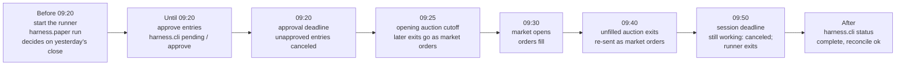
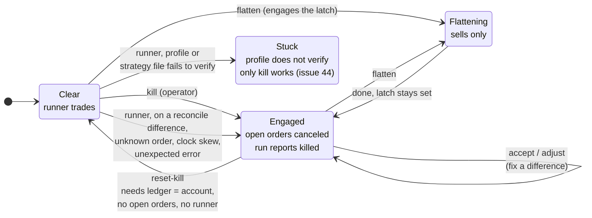

# Paper trading runbook

For the operator: how to set up, run and stop paper trading, and what to do when a day
does not go to plan. Design and reasons are in `docs/slice2-design.md`; this file is
only what to type and what to expect. `tests/test_paper_e2e.py` runs one week against
the fake venue with the faults an operator is most likely to meet (a late bar, a trade
made by hand, a process that dies, a missed session, flatten and the way back). The
other situations here are covered one at a time in `tests/test_paper.py`,
`tests/test_control.py` and `tests/test_cli.py`.

Paper trading here is attended. Nothing runs unattended until push alerts work and
there is an answer to "the machine was off" (see "Gate before unattended use" in the
design doc).

## The two command lines

| Command line | Commands | Talks to Alpaca |
|---|---|---|
| `uv run python -m harness.paper` | `promote`, `activate`, `run` | `activate` and `run` |
| `uv run python -m harness.cli` | views: `status`, `positions`, `orders`, `pending`, `alerts`, `profiles`; commands: `kill`, `reset-kill`, `approve`, `reject`, `reset-halt`, `flatten`, `accept`, `adjust` | `kill`, `reset-kill`, `flatten`, `accept` |

The views read files only. They are safe at any time, also while the runner is running.
Every command of `harness.cli` needs `--operator <name>`. The commands that change the
books record what they did in the journal under that name. `kill` is the exception: it
writes the latch and an alert only, and the journal first names it at `reset-kill`,
which records the latch it cleared.

Keys come from `.env` only (`ALPACA_PAPER_API_KEY`, `ALPACA_PAPER_SECRET_KEY`). They are
never exported and never logged.

## Where things are

All under `state/paper/` (`state_dir` in `config/execution.yaml`):

| Path | What |
|---|---|
| `KILL` | The kill latch. If it exists, or cannot be read, nothing sends an order. |
| `active.json` | The active profile, the account it is bound to, the approval mode. |
| `alerts.jsonl` | Every alert. `harness.cli alerts` prints them. |
| `logs/<date>.log` | The runner's log for the day. Only `harness.paper run` writes one. |
| `runner.lock` | Held by the runner, and by commands that must not run beside it. |
| `data_access_log.csv` | One line per day the runner read bars past the holdout cutoff. |
| `<profile id>/journal.jsonl` | The audit trail. Everything else in the folder is derived from it. |
| `<profile id>/equity.csv`, `trades.csv`, `summary.json` | Same schema as a backtest's files. |
| `<profile id>/ledger.json`, `orders.json`, `last_run.json`, `pending_approvals.json` | Snapshots the views read. |

`python -m harness.cli` sets up no log file. What it does goes to the journal and, as
alerts, to `alerts.jsonl`.

## Exit statuses

`python -m harness.cli`:

| Status | Meaning |
|---|---|
| 0 | The command did what it says. |
| 1 | It ran, and something is left for you: `kill` could not confirm the cancel or could not write the latch, or `flatten` left a position or a reconciliation difference. Read the output. |
| 2 | Refused or failed. The message on stderr says what was and was not done. A usage error is also 2. |
| 3 | It crashed. The traceback is on stderr, and how far it got is not known: check `status` and `positions`. |
| other | Ctrl-C ends the command with Python's own status for an interrupt, not 0 to 3. See "Ctrl-C during flatten". |

`python -m harness.paper run`:

| Status | Meaning |
|---|---|
| 0 | Outcome `traded`, `no_session` or `already_done`. |
| 1 | Outcome `killed`, `failed` or `skipped_stale_data`: the day did not finish. The printed alerts say why. Also 1, with a traceback: an error the runner did not expect. It engages the kill switch before it exits. |
| 2 | Refused before anything was touched (no active profile, not the active profile, another runner, config). Missing keys are not this: they are outcome `failed`, status 1. |
| other | Ctrl-C ends the runner with Python's own status for an interrupt. Nothing is canceled, the kill switch is not engaged, and orders already sent stay at Alpaca. `last_run.json` is not written, so `status` shows the previous run's outcome until the next run. |

## One-time setup

1. In the Alpaca paper account's settings, by hand: shorting off (`no_shorting`), margin
   multiplier 1, balance at or above the recipe's starting cash. The harness checks
   these every morning and never changes account settings.
2. Make a backtest run from a clean git tree, with a risk preset:
   `uv run python -m harness.run --strategy example_buy_and_hold --risk balanced`
3. Freeze it: `uv run python -m harness.paper promote backtests/<run> <name> --plumbing`
   (`--plumbing` is for the example strategy only; a real strategy needs a logged holdout
   run of the same recipe instead). It prints the profile id.
4. Bind the account:
   `uv run python -m harness.paper activate <profile id> --approval entries --operator <name>`
   It refuses unless the account is flat with no open orders, the kill latch is clear,
   and the profile has never traded. Cash above the starting cash is recorded as an
   offset and left alone.

A profile is frozen. Changing anything (params, risk, execution settings) means a new
backtest, a new profile, and a new activation with `--replace` on a flat account.

## A normal morning

Times are New York time, from `config/execution.yaml`.

Started after 09:20 with approval on, entries can no longer be approved that day.
Started after 09:50 on a day not yet decided, nothing is decided (`late_start`).

1. Start the runner before 09:20 if entries need approval, and in any case before 09:50:
   `uv run python -m harness.paper run`
   It decides on yesterday's close and trades today's open. Started after 09:50 on a day
   not yet decided, it decides nothing (`late_start`) and tomorrow carries on.
2. With `--approval entries`, in a second terminal:
   `uv run python -m harness.cli pending`, then
   `uv run python -m harness.cli approve <ORDER_ID=HASH> --operator <name>`
   Copy `ORDER_ID=HASH` as printed: the hash is what you looked at. An entry not approved
   by 09:20 is canceled (`approval_timeout`); the day still completes. Exits never wait.
3. The runner exits once every order is final, at the latest at 09:50. Check
   `uv run python -m harness.cli status`: `session <today>: complete`, last reconcile
   `ok`, no `problem:` lines.

Running the day a second time is safe: it reports `already_done` and sends nothing.

## When a day does not go to plan

| What you see | What happened | What to do |
|---|---|---|
| Outcome `skipped_stale_data` | Yesterday's bar of the benchmark is not there yet. Nothing was decided. | Nothing today. The alert says to run again once the bar is there, but a rerun the same day does not pick up a bar that arrives late, because the bar cache already counts that day as fetched (issue #34). The next morning's run fetches it and carries on, with a `missed_sessions` warning. |
| `missed_sessions` warning | The runner did not complete one or more sessions (machine off, stale data, a kill). | Nothing. It decides on the latest close. A day that was never decided has no row in `equity.csv`; a day that was decided and then killed has one. |
| Outcome `failed`, alert `venue_unavailable` | Alpaca did not answer after several tries. Nothing was sent after the failure. | Run again. |
| Outcome `failed`, alert `venue_setup` | The paper keys are missing from `.env`, or the venue could not be set up. Nothing was asked of Alpaca. | Fix `.env`, run again. |
| Outcome `failed`, alert `account_setup` or `wrong_account` | The account settings are not the safe ones, or the keys are for another account than the one activated. | Fix the account settings or `.env`, run again. |
| Outcome `failed`, alert `data` | The bars could not be loaded. No orders today. | Run again. If it keeps failing, check the Alpaca data API and the keys. |
| Outcome `failed`, alert `paper_access_log` | The paper access log (`data_access_log.csv`) cannot be read or written, so no bars past the holdout cutoff are read. No orders today. | Make the file readable and writable, run again. A critical `paper_access_log` alert saying holdout data was read without a real profile does not fail the day: find what read it. |
| Outcome `failed`, alert `state` | The journal, the saved state or the risk state does not load, or they disagree. Nothing was sent by this run (on a resumed day, an earlier run may already have sent orders). | Stop. Do not edit the files in `state/paper/<profile id>/` by hand; find out why first. |
| Outcome `failed`, alert `account_changed` | A second attempt at the same day's decision found a different equity than the first (something was booked in between, or a bar changed). Nothing was sent, exits included. | Check `orders` and `positions` against the account. The next session decides afresh. |
| Outcome `failed`, alert `decision_changed` | A second attempt at the same day's decision staged different orders than the first: the bars or the account changed in between. Nothing was sent. | Nothing. The next session closes the staged orders and decides afresh. |
| Outcome `failed`, alert `unknown_position` | The ledger holds a symbol outside the profile's universe, or one with no bar. No orders today. | Sell it at the broker, then `accept`, then run. |
| Outcome `failed`, alert `decision_failed` | The strategy raised. No orders; positions untouched. | The frozen strategy is broken: fix it in `strategies/`, backtest, promote and activate a new profile. |
| The process died (crash, power, Ctrl-C) | Whatever was sent is at Alpaca; the journal has the intent. | Run again. It resumes from the journal: it does not decide twice and does not send an order twice (order ids are fixed by the decision, and an unanswered send is looked up before anything is re-sent). Ctrl-C does not cancel anything, and `status` shows the run before it until the next run: to stop a day, use `kill`. |
| Outcome `killed` | The kill switch is engaged. See below. | See below. |

## The kill switch

Engaged means nothing sends an order until an operator resets it. It cancels open
orders; it never sells.

Nothing goes from Engaged back to Clear without `reset-kill`, and nothing on this
diagram buys. Only `flatten` sells.

- Engage it yourself, at any time, also while the runner is running or hung:
  `uv run python -m harness.cli kill --reason "<why>" --operator <name>`
  Status 1 means the cancel was not confirmed: check the broker and run `kill` again.
- The runner engages it on: a reconciliation difference, an order whose outcome is
  still unknown at the session deadline, an open workflow that could not finish, an
  order from another day still at the venue, clock skew over 30 seconds, a profile or
  strategy file that no longer verifies, any error it does not expect.
- `status` shows who engaged it, when, why, and whether the cancel was confirmed.
- While it is engaged, `run` reports `killed` and touches nothing.
- A hung runner holds `runner.lock`, so `reset-kill`, `reset-halt`, `flatten`, `accept`,
  `adjust` and `activate` are refused until that process is ended (`kill` still works).
  The lock is released when the process dies.
- If the kill was for a profile or strategy file that no longer verifies, only `kill`
  works: `reset-kill`, `flatten`, `accept`, `adjust` and `reset-halt` all load the
  profile and are refused, and a new profile cannot be activated while the latch is
  set. Positions can only be sold at the broker, and there is no way back yet
  (issue #44).

To reset:

1. Find out why (`status`, `alerts`), and fix that first.
2. `uv run python -m harness.cli reset-kill --confirm <profile id> --operator <name>`
   It books any fills made while stopped, then reconciles, and refuses (status 2) while
   the ledger and the account differ or any order is open at the venue.
3. Start the runner again. A runner that was running when the switch was engaged has
   exited; a reset never revives it.

If the latch file cannot be written (disk full, permissions), nothing stops the next
run. `kill` then exits 1 and says "THE LATCH FILE WAS NOT WRITTEN"; a kill made by the
runner says "THE LATCH IS NOT ON DISK" in its alert, and `status` shows the switch as
not engaged. Do not start the runner: make `state/paper/` writable and run `kill` again.

## The account and the ledger differ

Typical cause: an order placed by hand in the Alpaca dashboard, a dividend, a fee.
The runner kills before deciding anything, and the alert lists each difference.

- A dividend, split or fee with a known date: record the event, once per id:
  `uv run python -m harness.cli adjust --id 2026-07-01-SPY-dividend --as-of 2026-07-01 --kind dividend --symbol SPY --cash 4.20 --note "<why>" --operator <name>`
- Anything else: make the ledger agree with the broker:
  `uv run python -m harness.cli accept --note "<why>" --operator <name>`
  It refuses while orders are open at the venue, for a short position, for a symbol
  outside the profile's universe (sell that at the broker first), and when the broker
  gives no entry price for a position.
- Then `reset-kill`, then run.

After an `accept` or `adjust` that changes a share count, `trades.csv` and
`summary.json` stop updating (those shares have no fill behind them), and the runner
warns `report` every day. The ledger, `positions` and `equity.csv` stay correct. A new
profile starts a clean report.

## Flatten

`uv run python -m harness.cli flatten --confirm <profile id> --operator <name>`

Sells every position and nothing else. Started before 09:25 (`opg_cutoff`), the sells
go into the opening auction; from 09:25 on they go as market orders, which fill once the
market is open. It refuses on a day without a session,
after the close, and while the runner is running (engage the kill switch first to stop
a running day).

It also refuses on an account that fails the setup check (blocked, or one that may short
or borrow): fix the account settings first, or sell in the Alpaca dashboard and `accept`.
`kill` is different: it cancels open orders on such an account all the same.

It engages the kill switch as soon as the confirmation matches and leaves it engaged:
otherwise the next run would decide against a flat account and buy straight back. The
way back to trading is `reset-kill`. The next run then decides from a flat account, so
buy and hold enters again.

Status 1 means a position is still held or the account and ledger differ: the output
names each. Run `flatten` again, or sell at the broker and `accept`.

Status 2 with "stopped part way" means the order manager could no longer vouch for an
order (a sell whose outcome is unknown, or a cancel the venue did not confirm). The kill
switch is engaged, and there is no closing reconciliation, "still held" list or
`flatten` alert. Check `positions`, `orders`, `alerts` and the Alpaca dashboard. Then
run `flatten` again (it looks unresolved orders up at the venue and compares the ledger
with the account before it sells), or `reset-kill` to stop there.

An auction sell the venue rejects is final: the flatten ends with the position held,
and a second flatten before 09:25 is rejected the same way (issue #38). Run `flatten`
again from 09:25 on, when it sends market orders.

### Ctrl-C during flatten

Ctrl-C ends the command with Python's own exit status for an interrupt, not 0 to 3.
Sells already sent stay at Alpaca and the kill switch stays engaged. `status` and
`positions` show how far it got, and `flatten` can be run again: it cancels what is
open, compares the ledger with the account, and sells what is left.

If you decide not to sell after all: `kill` (it cancels the open sell), `reset-kill`,
then run. The runner closes the sell the flatten left behind and never sends it, with
a `flatten_unfinished` alert; the position stays. Until that run, `orders` still shows
the sell as not final.

## The drawdown halt

When equity falls far enough below its peak (the profile's risk preset), entries stop
and exits continue. `status` shows `HALTED` with the reason. After reviewing it:
`uv run python -m harness.cli reset-halt --reason "<why>" --operator <name>`
The peak restarts from current equity. Entries are allowed again from the next decision.
